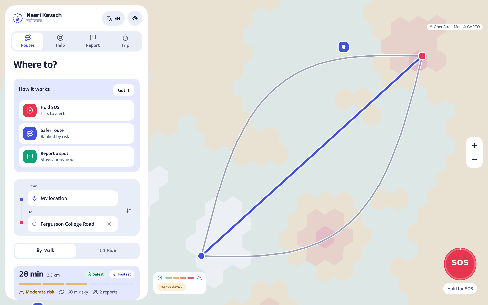
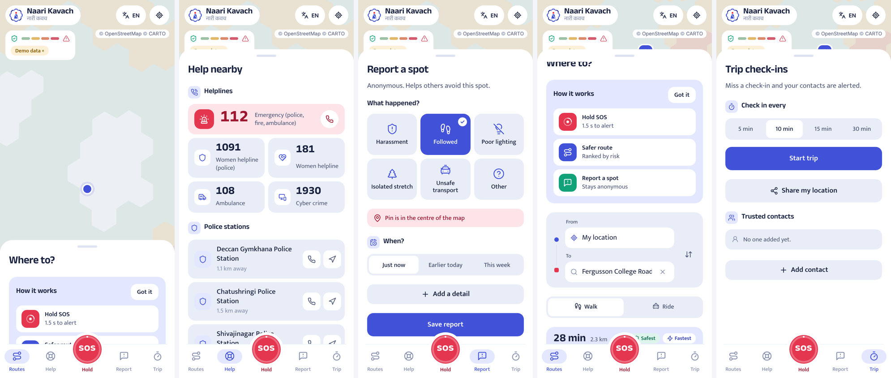

<p align="center"></p>

# Naari Kavach · नारी कवच

Safer routes, help in one hold. A free web app for women's everyday safety and
safe mobility in Maharashtra, by **Team ONYX** for the Seva First Innovation
Challenge 2026.

| | |
|---|---|
| **Routes** | Compare up to three routes, ranked by risk on a live hex map |
| **SOS** | Hold 1.5 s, 5 s to cancel, then call 112, text contacts, WhatsApp or share |
| **Help** | 112, 1091, 181, 108, 1930, plus the nearest police stations and hospitals |
| **Report** | Anonymous report of an unsafe spot; the map updates immediately |
| **Trip** | Checks in for you while you move; asks if you are okay only when you stop, leave your route or run late, then starts SOS. One tap tells contacts you started and arrived |
| **Living shield** | During a trip it watches more closely on risky ground, notices a walk that turns into vehicle speed or a ride heading away from the destination, and asks before she has to press anything |
| **Journey preview** | See where a route gets quiet, when it gets dark and how far apart open places are; play the route to rehearse it |
| **Daylight budget** | "Leave within 17 min to arrive before dark", from sunset worked out on the phone |
| **Pocket guide** | Turn cues by vibration and voice, so the phone stays in the pocket |
| **Quick tools** | Fake incoming call and a loud alarm, both offline |
| **Map** | Tap any area to see why it is marked; score the map for day, evening or night |

Works in English, मराठी and हिंदी. Installable (PWA). Light and dark mode.




## Brand

The **Kavach Mandala**: a woman at the centre, held by eight interlocking
crescents. Files, construction and rules are in [`brand/`](./brand) and
[`brand/brand-sheet.png`](./brand/brand-sheet.png).

## Run it

```bash
npm install
npm run dev
```

Open http://localhost:5173. No API keys needed.

Optional upgrades live in `.env.example` (OpenRouteService key for routes that
steer around risky blocks, Supabase for shared reports and Telegram SOS).

## How the risk map works

Each ~130 m hex gets a score from five signals: recent reports, darkness
(NASA night lights), isolation (open shops and transit nearby), district crime
rate (NCRB), and distance to police or hospitals. Night raises the score.
Missing signals are skipped. The app tracks places and times, never people.

Full architecture, design system and rules: [`CLAUDE.md`](./CLAUDE.md).

## Project layout

```
src/            React app (features/, components/, lib/, styles/)
public/         PWA manifest, service worker, icon
supabase/       Optional schema + Telegram SOS edge function
pipeline/       Python script that builds the static night-light and crime layer
brand/          Logo, lockups, app icons, brand sheet, generator script
docs/           Screenshots
```

## Deploy free

Vercel, Netlify or Azure Static Web Apps: build `npm run build`, output `dist/`.

## Data and credits

Map data and tiles © OpenStreetMap contributors. Routing by FOSSGIS OSRM.
Place search by Nominatim. Nearby police and hospitals by Overpass and Photon. Fonts: Anek Devanagari and Mukta by Ek Type (OFL).
Icons: Lucide (ISC).

Demo reports on the map are generated for demonstration and labelled
"Demo data". Hide them from the legend.
